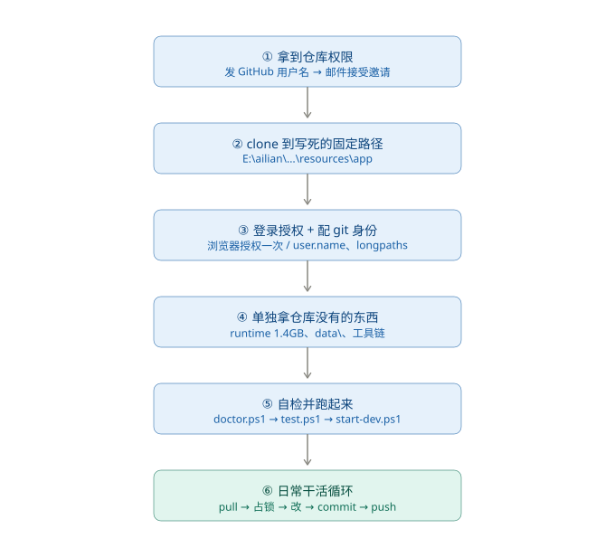

# 入手指南 · 图解版

> 配套：`入手指南-GitHub.md`（原文）　整理日：2026-10-30
> 本文只是把原文的六个阶段画成一张图 + 逐条要点，不替代原文。



---

## 六步逐条要点

| 阶段 | 做什么 | 关键命令 / 备注 |
| --- | --- | --- |
| ① 权限 | 把 GitHub 用户名发给老大，收到邀请邮件点 Accept | 私有仓库对非成员返回 **404**，不是 403 |
| ② clone | 必须落到 `E:\ailian\艾莲电脑版\创作版\resources\app` | 脚本写死 `E:\ailian\...`，换位置全报「找不到路径」 |
| ③ 授权 | 首次 push 弹窗选 Sign in with your browser | 绿色按钮点不动 → 无痕窗口重开 |
| ④ 补料 | `runtime\`(1.4G)、`data\`、工具链单独找老大拿 | `data\` 是真实聊天数据，**绝不入库、不外传** |
| ⑤ 验证 | `doctor.ps1` → `test.ps1` → `start-dev.ps1 -Isolated` | 全绿才动手；启动参数别手搓 |
| ⑥ 日常 | `git pull --rebase` → 占锁 → 改 → commit → push | 提交格式 `fix(phone): 中文说明` |

### ② clone

```powershell
mkdir E:\ailian\艾莲电脑版\创作版\resources -Force
cd E:\ailian\艾莲电脑版\创作版\resources
git clone https://github.com/yizhilangmiao/ellen-pc.git app
```

仓库根是 `...\resources\app\`，不是 `E:\ailian\`。

### ③ 配 git 身份

```powershell
git config --global user.name  "你的名字"
git config --global user.email "你的邮箱"
git config --global core.longpaths true
git config --global core.autocrlf false
```

走 HTTPS + Git Credential Manager，**不要折腾 SSH**（本机实测签名阶段必失败）。

### ⑤ 跑起来

```powershell
pwsh -File E:\ailian\.agents\doctor.ps1
pwsh -File E:\ailian\.agents\test.ps1                 # 基线 29 项
pwsh -File E:\ailian\工具\脚本\start-dev.ps1 -Isolated
```

验证口径：`app\data\logs\startup.jsonl` 出现新 run 的 `page-loaded`（UTC，本地 +8），任务管理器 6~8 个 ellen 进程。

### ⑥ 日常

```powershell
cd E:\ailian\艾莲电脑版\创作版\resources\app
git pull --rebase
pwsh -File E:\ailian\.agents\lock.ps1 -Target "艾莲电脑版\创作版\resources\app\src\main.cjs"
# 改完
pwsh -File E:\ailian\.agents\lock.ps1 -Target "…" -Release
```

分支策略：小改直推 `master`（推前必须 `pull --rebase`）；跨文件或两人同改 → `feat/<主题>`、`fix/<主题>` 开 PR。

---

## 红线

1. 不 `git push --force` 到 `master`
2. 不把 `data\`、`runtime\`、模型、APK、安装包塞进 git
3. 不提交单文件 ≥ 100 MB（GitHub 硬限）
4. 不擅自 commit 别人的改动、不擅自删远端分支
5. 手机版不走 GitHub，走 `_phone-sync\` 补丁流程；离线包传完回 GitHub 通道，别双线并行

## 什么进库、什么不进

```
# .gitignore 已写死
runtime/   data/   memory/node_modules/   memory/模型缓存/
logs/   _临时/   *.bak  *.tmp  *.old  *.zip  *.7z
```

入库：`src\`（含 `src\ui\assets\` 约 99.7 MB 素材）、`characters\`、`docs\`、`story\`、`memory\src\`、`tests\`、`boot*.cjs`、`package.json`。

---

## 故障速查

| 现象 | 原因 | 修法 |
| --- | --- | --- |
| clone 404 | 不在协作者里 | 让老大 Add people |
| `Permission denied (publickey)` | 用了 SSH 地址 | 换 HTTPS |
| `could not read Username` | 无界面环境 push | 在能弹窗的终端跑一次，或配 PAT |
| 绿色按钮点不动 | 浏览器扩展拦截 | 无痕窗口 / 加白名单 |
| 脚本报找不到路径 | 没摆成 `E:\ailian\...` | 按第二节重摆 |
| push 报文件超 100 MB | 超大文件被 add | `git rm --cached` + 加 `.gitignore` |
| `LF will be replaced by CRLF` | 换行符转换 | `core.autocrlf false` |
| 拉下来跑不起来 | 缺 1.4 GB `runtime` | 按第六节单独拿 |
